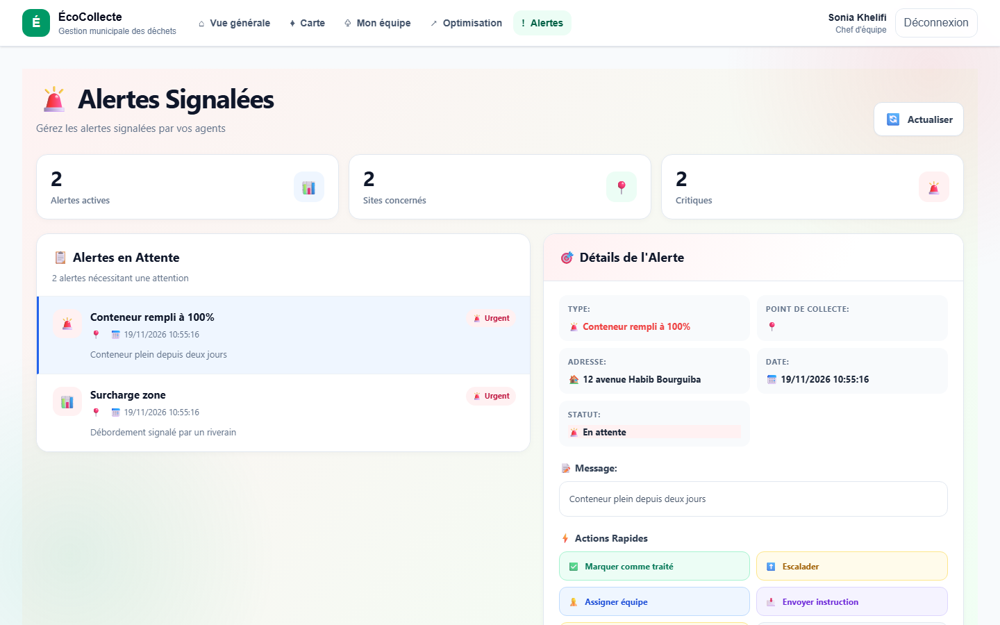
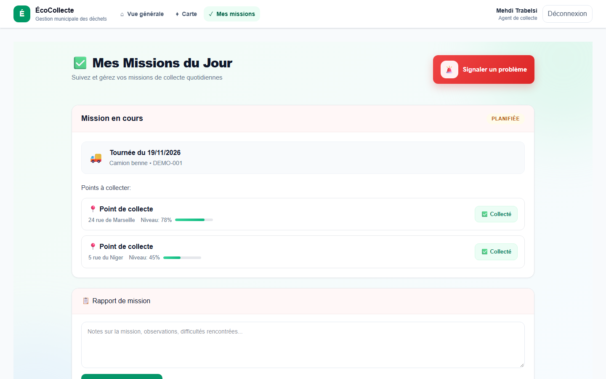
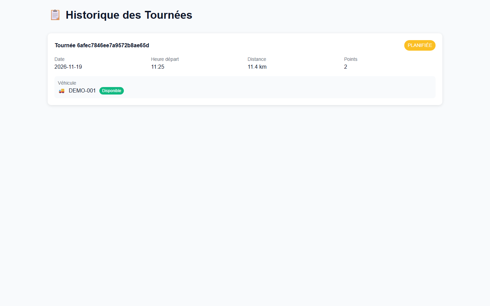

# Gestion municipale des déchets

[](https://github.com/Hadir11/gestion-dechets-backend/actions/workflows/ci.yml)


API REST et interface web pour piloter la collecte des déchets d’une municipalité : points de collecte, alertes de remplissage, équipes, véhicules et tournées optimisées.

Le projet est traité comme une application réelle, pas comme un exercice : authentification, autorisations par rôle, tests, intégration continue, documentation OpenAPI et configuration de déploiement. Un jeu de données de démonstration permet de le voir fonctionner en deux minutes.

---

## Aperçu

**Aperçu en ligne** (maquette statique, sans installation) : <https://hadir11.github.io/gestion-dechets-backend/maquette-eco-collecte.html>

| Tableau de bord administrateur | Alertes du chef d’équipe |
| :---: | :---: |
|  |  |
| **Missions de l’agent de collecte** | **Tournées planifiées** |
|  |  |

Trois rôles, trois expériences :

| Rôle | Ce qu’il voit | Ce qu’il peut faire |
| --- | --- | --- |
| **Administrateur** | Tableau de bord global, effectifs, points de collecte, tournées | Créer et supprimer des comptes, gérer les employés, véhicules et zones |
| **Chef d’équipe** | Son équipe, les alertes urgentes, l’optimisation | Affecter un agent à une tournée, traiter, escalader ou ignorer une alerte |
| **Agent de collecte** | Ses missions du jour, la carte des points | Consulter ses tournées, signaler un incident ou un conteneur plein |

L’optimisation prend les points au-dessus de 70 % de remplissage, calcule le meilleur ordre de passage par **Dijkstra** et n’affecte la tournée qu’à un véhicule et un agent réellement disponibles.

---

## Points forts

### Sécurité

- **Chaîne JWT stateless** : filtre réactivé et branché avant `UsernamePasswordAuthenticationFilter`, aucune session serveur, jeton Bearer validé à chaque requête.
- **Autorisations par rôle** à deux niveaux — règles d’URL et `@PreAuthorize` sur les contrôleurs — avec un refus explicite en 401 (non authentifié) et 403 (non autorisé), distincts d’un 404.
- **Normalisation des rôles centralisée** : `AGENT_COLLECTE`, `AGENT`, `chef-equipe` convergent vers une seule autorité, de sorte que le filtre, les tableaux de bord et les contrôleurs ne peuvent pas diverger.
- **Comptes** : mots de passe BCrypt (12 caractères minimum), unicité de l’identifiant et de l’e-mail, inscription réservée à l’administrateur, premier compte créé par un jeton de bootstrap à usage unique.
- **Aucune fuite dans les réponses** : `password`, `authorities` et les getters internes de `UserDetails` sont exclus de la sérialisation JSON.
- **CORS explicite** : origine unique configurable, cookies inter-origines désactivés, requêtes d’origine inconnue rejetées.

- **Limitation des tentatives** : cinq échecs par identifiant bloquent la connexion pendant quinze minutes et renvoient un 429 ; une connexion réussie remet le compteur à zéro.

### Qualité et outillage

- **20 tests automatisés** qui ne dépendent pas de MongoDB : la matrice d’accès est vérifiée à travers la vraie chaîne de filtres Spring Security, avec des jetons signés.
- **CI GitHub Actions** sur chaque push et chaque pull request : `mvn verify` et `npm run build`.
- **Documentation OpenAPI** servie par Swagger UI, schéma `bearer` inclus pour essayer les routes protégées depuis le navigateur.
- **Build Docker multi-étapes**, image JRE Alpine, utilisateur non privilégié, sonde de santé `/actuator/health`.
- **Jeu de démonstration idempotent** : un clone neuf n’affiche pas des tableaux de bord vides.

### Métier

- Modèle complet : zones, points de collecte, déchets, alertes, équipes, employés, véhicules, tournées.
- Optimisation de tournée par plus court chemin (Dijkstra) sur un graphe de points géolocalisés, avec distance de Haversine.
- Alertes typées et cycle de vie complet : traiter, escalader, ignorer, assigner une équipe, envoyer une instruction, replanifier.
- Statistiques de tableau de bord calculées depuis la base — plus aucun chiffre codé en dur.

---

## Architecture

```
gestion-dechets/
├── src/main/java/org/municipalite/gestiondechets/
│   ├── config/        SecurityConfig, JwtAuthenticationFilter, CORS, OpenAPI, seed de démo
│   ├── controller/    14 contrôleurs REST (auth, employés, alertes, tournées, IA…)
│   ├── model/         entités MongoDB (Employe implémente UserDetails)
│   ├── repository/    Spring Data MongoDB
│   └── service/       logique métier + implémentations
├── src/test/java/     tests de sécurité et de normalisation des rôles
├── frontend/          Next.js 16 + React + TypeScript (15 écrans)
├── Dockerfile         build multi-étapes
├── render.yaml        blueprint de déploiement
└── docs/              guide de déploiement, maquette
```

**68 fichiers Java**, **14 contrôleurs**, **67 routes**, **15 écrans** côté interface.

---

## Matrice des accès

| Route | Anonyme | Agent | Chef d’équipe | Admin |
| --- | :---: | :---: | :---: | :---: |
| `POST /api/auth/login` | ✅ | ✅ | ✅ | ✅ |
| `POST /api/auth/bootstrap-admin` | 🗝️ jeton | — | — | — |
| `POST /api/auth/register` | ❌ | ❌ | ❌ | ✅ |
| `GET /api/**` (lecture) | ❌ | ✅ | ✅ | ✅ |
| `POST /api/alertes` | ❌ | ✅ | ✅ | ✅ |
| `GET /api/agent/mes-tournees` | ❌ | ✅ | ❌ | ❌ |
| `GET /api/chef/**` | ❌ | ❌ | ✅ | ✅ |
| `GET /api/tournees` | ❌ | ❌ | ✅ | ✅ |
| `POST`/`PUT`/`PATCH /api/**` | ❌ | ❌ | ✅ | ✅ |
| `DELETE /api/**` | ❌ | ❌ | ❌ | ✅ |
| `/api/test/**` | ❌ | ❌ | ❌ | ❌ |

Chaque ligne est couverte par un test : rouvrir une route par erreur fait échouer la CI.

---

## Démarrage en deux minutes

Prérequis : JDK 17, Maven, MongoDB, Node.js 22.

```powershell
# 1. Configuration locale
Copy-Item src/main/resources/application-local.properties.example src/main/resources/application-local.properties
#    → adaptez l'URI MongoDB et le secret JWT (32 caractères minimum)

# 2. API + jeu de démonstration
mvn spring-boot:run "-Dspring-boot.run.profiles=local,demo"

# 3. Interface
cd frontend
npm ci
Copy-Item .env.example .env.local
npm run dev
```

- API : <http://localhost:18081> — documentation : <http://localhost:18081/swagger-ui.html>
- Interface : <http://localhost:3000>
- Comptes de démonstration : `admin`, `chef`, `agent` — mot de passe `admin123`

Le profil `demo` crée 3 zones, 8 points de collecte, 6 employés, 3 véhicules, une équipe, 3 alertes et une tournée planifiée. Il ne fait rien si la base contient déjà des employés.

### Création du premier administrateur (hors démonstration)

```powershell
$env:BOOTSTRAP_ADMIN_TOKEN = [guid]::NewGuid().ToString('N')
mvn spring-boot:run "-Dspring-boot.run.profiles=local"
```

Puis appelez `POST /api/auth/bootstrap-admin` avec l’en-tête `X-Bootstrap-Token` et le compte à créer. Le point d’entrée refuse toute création dès qu’un administrateur existe ; retirez ensuite la variable.

---

## Tests et intégration continue

```powershell
mvn test
```

| Suite | Couverture |
| --- | --- |
| `EmployeAuthoritiesTest` | Normalisation des rôles, rôle absent, absence de `password` et `authorities` dans le JSON |
| `LoginAttemptServiceTest` | Cinq échecs bloquent un identifiant, un succès le débloque, les comptes restent indépendants |
| `SecurityRulesTest` | Chaîne de filtres réelle : anonyme et jeton invalide rejetés, agent bloqué sur les tournées, admin bloqué sur l’endpoint agent, `/api/test/**` fermé, route inconnue en 404, création d’alerte en 201 |

Aucun test ne nécessite MongoDB : `mvn test` passe sur un clone vierge. La CI rejoue ces tests et le build frontend à chaque push sur `main` et sur chaque pull request.

---

## Documentation de l’API

- Swagger UI : `/swagger-ui.html`
- Contrat brut : `/v3/api-docs`

Connectez-vous via `POST /api/auth/login`, puis cliquez sur **Authorize** et collez le jeton pour essayer les routes protégées.

---

## Déploiement

- **Image Docker** : `docker build -t gestion-dechets .` — multi-étapes, JRE Alpine, utilisateur non privilégié, profil `prod`.
- **Render** : le fichier [`render.yaml`](render.yaml) décrit le service ; `MONGODB_URI` et `CORS_ALLOWED_ORIGINS` sont à renseigner, `JWT_SECRET` est généré.
- **Vercel** : déploie `frontend/` avec `NEXT_PUBLIC_API_BASE_URL` pointant vers l’API publique.

Le profil `prod` n’accepte aucune valeur par défaut pour les secrets : il refuse de démarrer sans `MONGODB_URI`, `JWT_SECRET` (32 octets minimum) et `CORS_ALLOWED_ORIGINS`.

Déroulé complet, étape par étape : [docs/DEPLOIEMENT.md](docs/DEPLOIEMENT.md).

---

## Limites connues

Un projet de portfolio gagne à dire ce qu’il ne fait pas encore :

- Pas de tests côté frontend ni de lint configuré ; la CI ne vérifie que la compilation TypeScript.
- Pas de jeton de rafraîchissement : à l’expiration, il faut se reconnecter.
- Pas de pagination sur les listes.
- Les fonctions dites « IA » (prédiction de remplissage, anomalies) sont des heuristiques, pas des modèles entraînés.

---

## Licence

MIT — voir [LICENSE](LICENSE). Le code peut être réutilisé, modifié et redistribué en conservant l’avis de copyright.

## État du projet

Projet de démonstration et de portfolio. Les fonctions de prédiction et d’optimisation reposent en partie sur des heuristiques ou des données de démonstration ; elles ne constituent pas un système validé pour une exploitation municipale réelle.
