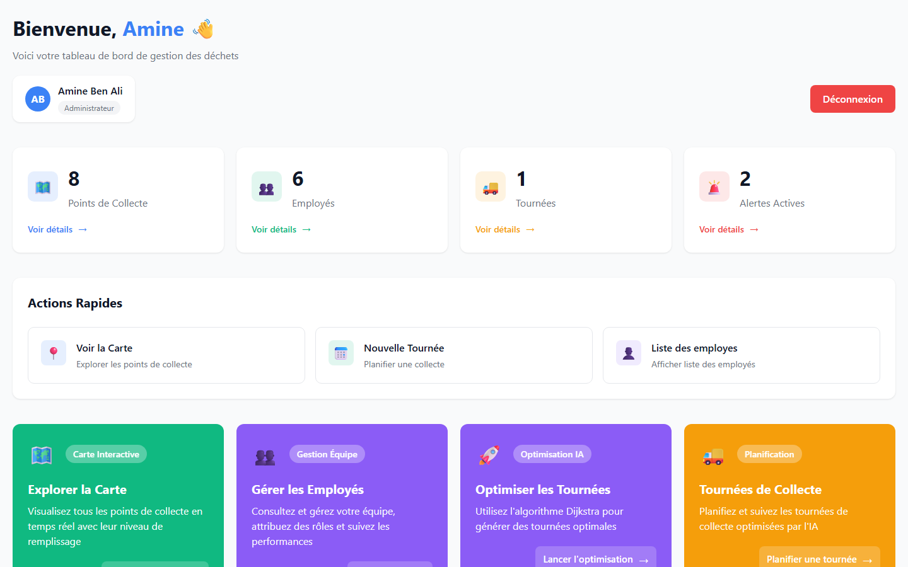

# Gestion des déchets

[](https://github.com/Hadir11/gestion-dechets-backend/actions/workflows/ci.yml)


Une application pour organiser la collecte des déchets dans une commune. Il y a une API en Spring Boot et une interface en Next.js, avec trois sortes de comptes : administrateur, chef d'équipe et agent de collecte.

Le sujet m'a plu parce qu'il y a un vrai problème derrière. Avec un seul camion et une matinée devant soi, il faut décider quels conteneurs ramasser d'abord, et ce n'est pas évident quand on en a huit répartis dans trois quartiers.



## Ce que fait l'application

L'administrateur gère les comptes, les employés, les véhicules et les zones. Le chef d'équipe surveille les alertes, affecte les agents et lance l'optimisation. L'agent voit les tournées du jour sur son écran et peut signaler un problème depuis le terrain.

Les alertes ont une vraie vie : on peut les traiter, les escalader, les ignorer, les assigner à une équipe, envoyer une instruction ou replanifier la tournée concernée.

| Chef d'équipe | Agent |
| :---: | :---: |
|  |  |

## L'optimisation des tournées

Le service prend les points dont le remplissage dépasse 70 %, construit un graphe à partir de leurs coordonnées et cherche le plus court chemin avec Dijkstra. Les distances sont calculées avec la formule de Haversine.

Une tournée n'est créée que si un véhicule et un agent sont réellement disponibles. S'il n'y a aucun point critique, le service ne fabrique pas de fausse tournée : il renvoie une liste vide et l'API répond « aucun point critique à collecter ». J'ai préféré ça aux données inventées qu'on trouvait au départ.

## La sécurité

Quand j'ai récupéré le projet, toutes les routes étaient ouvertes : le filtre JWT était entièrement commenté. Il a fallu le réactiver et décider qui a le droit de faire quoi.

Aujourd'hui il y a un jeton JWT sans session côté serveur, des rôles vérifiés à deux endroits (les règles d'URL et les annotations sur les contrôleurs), et les mots de passe sont hachés en BCrypt avec un minimum de douze caractères. Un utilisateur non connecté reçoit une 401, un utilisateur connecté qui n'a pas le rôle reçoit une 403, et les deux ne se confondent plus avec une 404.

Les codes de rôle étaient un peu partout (`AGENT_COLLECTE`, `AGENT`, `chef-equipe`). Ils passent maintenant par une seule fonction de normalisation, sinon le filtre et les tableaux de bord finissent par ne plus être d'accord.

J'ai aussi ajouté une limite sur les tentatives de connexion : cinq échecs bloquent l'identifiant pendant quinze minutes.

## Lancer le projet

Il faut Java 17, Maven, MongoDB et Node 22.

```powershell
Copy-Item src/main/resources/application-local.properties.example src/main/resources/application-local.properties
# adaptez l'URI MongoDB et le secret JWT

mvn spring-boot:run "-Dspring-boot.run.profiles=local,demo"

cd frontend
npm ci
Copy-Item .env.example .env.local
npm run dev
```

L'API tourne sur http://localhost:18081 et l'interface sur http://localhost:3000. Les comptes de démonstration sont `admin`, `chef` et `agent`, tous avec le mot de passe `admin123`.

Le profil `demo` remplit la base au premier démarrage : trois zones, huit points de collecte, six employés, trois véhicules, une équipe, trois alertes et une tournée. Si la base contient déjà des employés, il ne fait rien. C'est ce qui évite d'arriver sur des écrans vides quand on clone le dépôt.

Pour une base vierge sans données de démonstration, il y a un jeton de création du premier administrateur :

```powershell
$env:BOOTSTRAP_ADMIN_TOKEN = [guid]::NewGuid().ToString('N')
mvn spring-boot:run "-Dspring-boot.run.profiles=local"
```

On appelle ensuite `POST /api/auth/bootstrap-admin` avec l'en-tête `X-Bootstrap-Token`. L'endpoint refuse toute nouvelle création dès qu'un administrateur existe, et la variable doit être retirée après usage.

## Tests

```powershell
mvn test
```

Vingt tests, aucun n'a besoin de MongoDB, donc ils passent sur un clone vide. Les plus utiles sont ceux de `SecurityRulesTest` : ils passent par la vraie chaîne de filtres Spring Security avec des jetons signés, et vérifient la matrice d'accès complète. Si quelqu'un rouvre une route par erreur, la CI le dit.

Il y a aussi des tests sur la normalisation des rôles et sur la limitation des tentatives de connexion.

## L'API

Une fois l'API démarrée, la documentation est sur http://localhost:18081/swagger-ui.html. On se connecte avec `/api/auth/login`, puis le bouton « Authorize » permet d'envoyer le jeton et d'essayer les routes protégées. Le contrat brut est sur `/v3/api-docs`.

Quelques routes, avec ce qu'il faut pour y accéder :

| Route | Qui |
| --- | --- |
| `POST /api/auth/login` | tout le monde |
| `POST /api/auth/register` | administrateur seulement |
| `GET /api/alertes` | connecté |
| `POST /api/alertes` | agent, chef, administrateur |
| `GET /api/agent/mes-tournees` | agent seulement |
| `GET /api/chef/agents` | chef et administrateur |
| `DELETE /api/**` | administrateur seulement |

## Déploiement

Le `Dockerfile` fait un build en deux étapes et lance l'application sous un utilisateur non root. `render.yaml` décrit le service pour Render ; `MONGODB_URI` et `CORS_ALLOWED_ORIGINS` sont à renseigner, le secret JWT est généré.

Le profil `prod` refuse de démarrer si `MONGODB_URI`, `JWT_SECRET` ou `CORS_ALLOWED_ORIGINS` manquent. C'est volontaire : une application qui démarre avec des valeurs par défaut finit toujours par tourner en production avec ces valeurs.

Le détail des étapes, Atlas compris, est dans [docs/DEPLOIEMENT.md](docs/DEPLOIEMENT.md).

## Ce qui n'est pas fait

Autant le dire plutôt que de le laisser découvrir.

- Le frontend n'a ni tests ni lint. La CI ne vérifie que la compilation TypeScript.
- Il n'y a pas de jeton de rafraîchissement. Quand le jeton expire, il faut se reconnecter.
- Les listes ne sont pas paginées.
- Les fonctions dites « IA » (prédiction de remplissage, détection d'anomalies) sont des heuristiques maquillées, pas des modèles entraînés. Elles sont là pour la démonstration.
- La limitation des tentatives est en mémoire. Elle protège une seule instance et se remet à zéro au redémarrage.

## Licence

MIT, voir [LICENSE](LICENSE).
